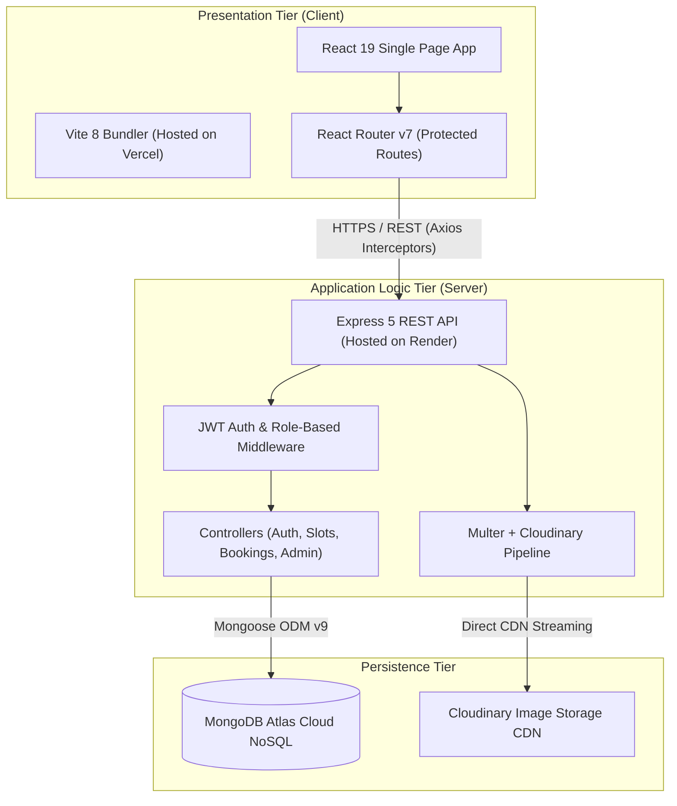
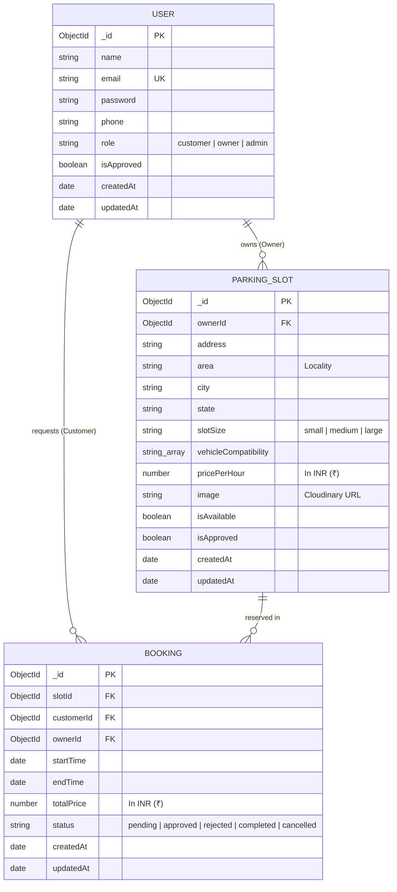

# ParkEase — Project Report

## Smart Parking Slot Rental & Availability Platform

**Submitted by:** Anas Ghayas  
**Date:** July 2026 (Updated October 2026)  
**Repository:** [github.com/anasghayas/ParkEase](https://github.com/anasghayas/ParkEase)  
**Live Demo:** [https://parkease-ecru.vercel.app/](https://parkease-ecru.vercel.app/)

---

## 1. Executive Summary & Problem Statement

### 1.1 Problem Statement
Urban mobility across India faces severe challenges due to rapid vehicular growth and uncoordinated parking infrastructure. Drivers in major metropolises (Mumbai, Delhi, Bangalore, etc.) and Tier-2 growth hubs (Jamshedpur, Pune, Lucknow) waste significant time searching for available parking, burning fuel and intensifying road congestion. Concurrently, commercial spaces and private property owners with unutilized driveways or parking bays lack an accessible, trustworthy digital marketplace to monetize their spaces safely.

### 1.2 Proposed Solution
**ParkEase** is an end-to-end Smart Parking Slot Rental and Availability Platform engineered to provide:
1. **Pan-India Coverage & Hyperlocal Discovery:** A 3-tiered cascading search model (State → City → Area/Locality) allowing users to reserve slots at exact neighborhood landmarks.
2. **Role-Based Access Control:** Dedicated, purpose-built dashboards for Customers (Drivers), Parking Owners (Allotters), and Super Administrators.
3. **Dynamic Rental Calculation:** Flexible duration booking (Hours, Days, Weeks) with real-time price quotation in Indian Rupees (₹).
4. **Frictionless Onboarding & Verification:** Unauthenticated visitors can seamlessly browse available slots across India and be gracefully guided through registration/login without 401 exceptions.

---

## 2. System Architecture & Design

### 2.1 Architecture Overview
ParkEase follows a decoupled 3-tier MERN client-server architecture:

### 2.2 Entity Relationship Diagram (ERD)

---

## 3. Implementation Details

### 3.1 Pan-India Cascading Discovery
To address mentor feedback regarding city and locality-level granularity across India:
- **Hierarchical Indexing:** Slots contain indexed `state`, `city`, and `area` attributes.
- **Dynamic Endpoint (`GET /api/slots/locations`):**
  - Without parameters: Returns unique sorted states and cities.
  - `?state=Maharashtra`: Returns cities in Maharashtra.
  - `?state=Maharashtra&city=Mumbai`: Returns localities in Mumbai (Andheri, Bandra, Colaba, Juhu, Lower Parel, Powai).
- **Client Cascading Selectors:** In `Home.jsx`, selecting a state dynamically updates the city selector, which subsequently unlocks the locality selector.

### 3.2 Authentication & Guest UX Safeguards
- **Elimination of Unhandled 401s:** In `SlotDetails.jsx`, visitors not yet authenticated are presented with a **"Login to Book Slot"** CTA instead of submitting an unauthenticated booking request.
- **Return Redirection:** The application appends `?redirect=/slot/:id`, allowing the user to log in or register and automatically resume booking without losing context.
- **Role Isolation:** Customers cannot access Owner actions, and Owners/Admins cannot reserve customer slots without switching accounts.

### 3.3 Dynamic Booking Lifecycle
The booking workflow follows a strict state transition machine:
1. **Request:** Driver selects duration and start time; status becomes `pending`.
2. **Review:** Slot allotter (Owner) evaluates request in their dashboard.
3. **Decision:** Owner clicks **Approve** or **Reject**.
4. **Cancellation:** Driver can cancel any `pending` booking via `DELETE /api/bookings/:id`.

---

## 4. Testing & Validation

### 4.1 Demo Accounts
The system contains pre-configured credentials for evaluation:

| Role | Email | Password | Validated Features |
|---|---|---|---|
| 🛡️ **Super Admin** | `admin@parkease.com` | `admin123` | Analytics overview (127 slots, users, revenue in ₹), slot verification table |
| 🏢 **Parking Owner** | `p@example.com` | `123456` | 45 assigned slots across India, incoming pending requests, slot management |
| 🚗 **Driver (Customer)** | `d@example.com` | `123456` | Pre-populated bookings, cancellation, 1-click slot booking |

### 4.2 Endpoint Verification Suite

| # | Method | Endpoint | Access | Purpose | Status |
|---|---|---|---|---|---|
| 1 | POST | `/api/auth/register` | Public | User registration with bcrypt hashing | Pass |
| 2 | POST | `/api/auth/login` | Public | JWT issue & validation | Pass |
| 3 | GET | `/api/slots` | Public | Filter slots by state, city, area | Pass |
| 4 | GET | `/api/slots/locations` | Public | Cascading location extraction | Pass |
| 5 | GET | `/api/slots/my-slots` | Owner | Fetch provider-owned listings | Pass |
| 6 | GET | `/api/slots/:id` | Public | Fetch slot by ID with populated owner | Pass |
| 7 | POST | `/api/slots` | Owner | Add slot with Cloudinary upload | Pass |
| 8 | DELETE | `/api/slots/:id` | Owner | Remove provider slot | Pass |
| 9 | POST | `/api/bookings` | Customer | Create booking request | Pass |
| 10 | GET | `/api/bookings/my-bookings`| Customer | Fetch customer reservations | Pass |
| 11 | GET | `/api/bookings/requests` | Owner | Fetch incoming owner requests | Pass |
| 12 | PATCH | `/api/bookings/:id/status`| Owner | Approve / Reject booking | Pass |
| 13 | DELETE | `/api/bookings/:id` | Customer | Cancel pending reservation | Pass |
| 14 | GET | `/api/admin/stats` | Admin | Aggregated platform metrics in ₹ | Pass |

---

## 5. Mentor Feedback Resolution Summary

| Mentor Observation | Root Cause | Engineering Solution |
|---|---|---|
| *"No clear option to book a parking slot, and no parking slots are being displayed"* | Database previously lacked populated demo data; Customer Dashboard only showed a history table with no direct slot discovery. | 1. Seeded **127 pre-approved slots** across 10 states. 2. Embedded **"Available Parking Slots Across India"** directly inside Customer Dashboard with 1-click booking. 3. Added prominent **"Find & Book a Parking Slot"** hero action banner. |
| *"Booking Without Login: Received 401 error"* | Guest users could trigger the booking API without an active token. | 1. Conditioned CTA to display **"Login to Book Slot"**. 2. Redirects to `/login?redirect=/slot/:id` with preservation. 3. Added 1-click Quick Demo login buttons on login page. |
| *"Should provide city-wise and area/locality-wise parking selection"* | Schema only supported a single string `city` without locality hierarchy. | 1. Added `state` and `area` to `ParkingSlot` schema. 2. Built cascading State → City → Area dropdowns. 3. Added metro city quick-select buttons. |
| *"Pan-India Availability"* | Initial placeholders referenced US/UK cities with `$` currency. | 1. Populated 15+ Indian cities across 10 states. 2. Converted all pricing and revenue across platform to Indian Rupee (**₹**). |

---

## 6. Deployment & CI/CD Pipeline

The project is hosted in a production environment:
- **Frontend:** Hosted on **Vercel** (`https://parkease-ecru.vercel.app/`), automatically building from the `client/` directory on pushes to `main`.
- **Backend:** Hosted on **Render**, listening on port 5001 and connecting to MongoDB Atlas.
- **Continuous Deployment:** Any commit pushed to `origin/main` automatically triggers Vercel and Render deployment webhooks for zero-downtime updates.

---

## 7. Conclusion
ParkEase delivers a complete, secure, and intuitive solution for smart parking slot rentals across India. By addressing mentor feedback with hierarchical search, comprehensive seeding, graceful authentication flows, and localized currency, the platform is robust, functional, and production-ready.
