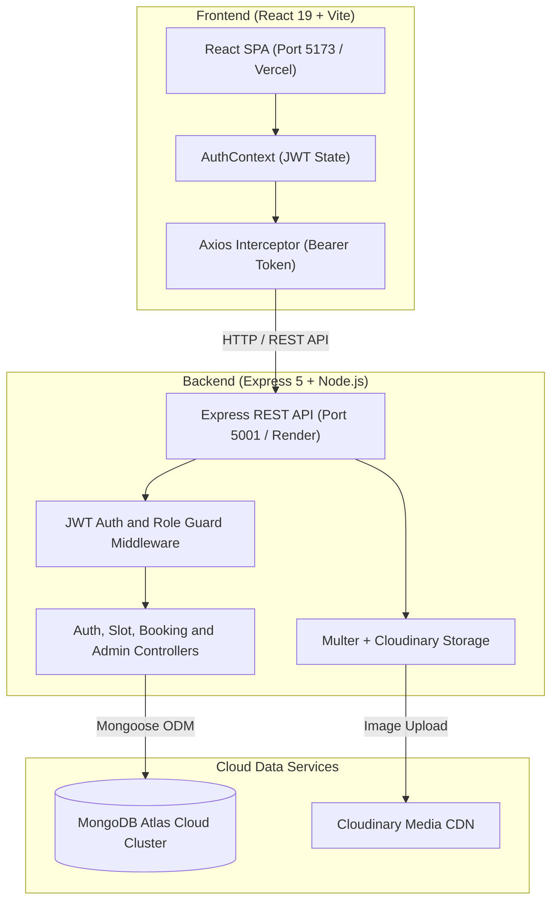

# 🅿️ ParkEase — Smart Parking Slot Booking System

> **Live Demo:** [https://parkease-ecru.vercel.app/](https://parkease-ecru.vercel.app/)

ParkEase is a production-ready, full-stack **MERN** web application that connects parking slot owners with drivers looking for convenient, secure parking across India. It features **three distinct user roles** (Customer, Owner, Admin), Pan-India 3-tier location filtering (State → City → Locality), real-time booking lifecycle management, Cloudinary image uploads, dynamic pricing in Indian Rupees (₹), and a premium dark-themed UI.

---

## 📑 Table of Contents

- [Live Demo](#-parkease--smart-parking-slot-booking-system)
- [Key Features](#-features)
- [Pan-India Coverage](#-pan-india-coverage)
- [Demo Accounts](#-demo-accounts)
- [Tech Stack](#-tech-stack)
- [System Architecture](#-system-architecture)
- [Database Schema](#-database-schema)
- [API Endpoints](#-api-endpoints)
- [Project Structure](#-project-structure)
- [Getting Started](#-getting-started)
- [Database Seeding](#-database-seeding)
- [License](#-license)

---

## ✨ Features

### 🚗 Customer (Driver)
- **Pan-India Location Discovery:** Find parking by State, City, and Area/Locality with cascading dropdowns and quick metro pills.
- **Direct Dashboard Discovery:** Browse featured available slots and book directly inside the Customer Dashboard.
- **Dynamic Booking:** Select start date/time and duration in **Hours, Days, or Weeks**.
- **Real-Time Price Calculator:** Instantly estimates total cost in Indian Rupees (₹).
- **Authentication-Aware Booking Flow:** Unauthenticated users see "Login to Book Slot" with automatic return-to-slot redirection, preventing unhandled 401 errors.
- **Reservation Management:** Track booking statuses (Pending, Approved, Rejected) and cancel pending requests.

### 🏢 Owner (Parking Space Allotter)
- **List Spaces:** Add parking slots with address, state, city, area/locality, slot size, vehicle compatibility, hourly rate (₹), and photo upload.
- **Cloudinary CDN Integration:** Direct multipart image uploads to Cloudinary.
- **Request Approvals:** Real-time dashboard to **Approve** or **Reject** driver booking requests.
- **Slot Management:** View active/pending listings and remove listed slots at any time.
- **Earnings Tracker:** Summary cards for total earnings, pending request counts, and listed slots.

### 🛡️ Admin
- **Platform Analytics:** Total registered users, total parking slots, total bookings, and platform revenue in ₹.
- **Slot Verification & Oversight:** Review, approve, or suspend any parking slot listing across India.
- **Pre-Seeded Access:** Instant platform oversight using the admin account.

### 🎨 UI/UX Design
- **Tailored Dark Aesthetic:** Sleek black (`#000000`) and dark slate (`#111111`) palette.
- **Responsive Layout:** Optimized for mobile, tablet, and desktop screens.
- **Feedback & Notifications:** Toast notifications via React Hot Toast for all asynchronous actions.
- **1-Click Quick Demo Login:** Instantly fill Driver or Owner credentials on the login screen.

---

## 🇮🇳 Pan-India Coverage

The platform is seeded with **127 pre-approved parking slots** across **10 Indian States & 15+ Cities**:

| State | Cities Covered | Sample Localities / Areas |
|---|---|---|
| **Jharkhand** | Jamshedpur, Ranchi | Bistupur, Sakchi, Sonari, Kadma, Telco, Lalpur, Doranda |
| **Maharashtra** | Mumbai, Pune | Andheri, Bandra, Colaba, Juhu, Koregaon Park, Hinjewadi |
| **Delhi NCR** | New Delhi, Central Delhi, Noida | Connaught Place, Saket, Dwarka, Karol Bagh, Sector 18 |
| **Karnataka** | Bangalore | Koramangala, Indiranagar, Whitefield, MG Road, HSR Layout |
| **West Bengal** | Kolkata | Park Street, Salt Lake, New Town, Howrah, Esplanade |
| **Tamil Nadu** | Chennai | T. Nagar, Anna Nagar, Adyar, Velachery, Nungambakkam |
| **Telangana** | Hyderabad | Banjara Hills, HITEC City, Gachibowli, Jubilee Hills |
| **Uttar Pradesh** | Lucknow, Noida | Hazratganj, Gomti Nagar, Aminabad, Sector 62 |
| **Rajasthan** | Jaipur | MI Road, C-Scheme, Vaishali Nagar, Malviya Nagar |
| **Gujarat** | Ahmedabad | CG Road, SG Highway, Navrangpura, Satellite |

---

## 🧪 Demo Accounts

Use these pre-registered accounts to test the application immediately:

| Role | Email | Password | Pre-populated Data |
|---|---|---|---|
| 🛡️ **Admin** | `admin@parkease.com` | `admin123` | Full system metrics (127 slots, revenue in ₹) |
| 🏢 **Parking Owner** | `p@example.com` | `123456` | Owns 45 slots across India; has pending requests to approve |
| 🚗 **Driver (Customer)** | `d@example.com` | `123456` | Active pending & approved bookings; 1-click booking access |

---

## 🛠️ Tech Stack

### Frontend
- **React 19** — Component-based SPA architecture
- **Vite 8** — Fast bundler & dev server
- **React Router DOM 7** — Client-side routing with query redirect preservation
- **Tailwind CSS 3** — Utility-first modern responsive styling
- **Axios** — HTTP client with Bearer token interceptor
- **Lucide React** — Consistent modern iconography
- **React Hot Toast** — Toast notifications
- **jwt-decode** — Client-side token payload decoding

### Backend
- **Node.js** & **Express 5** — Scalable RESTful API
- **Mongoose 9** — Schema modeling and MongoDB ODM
- **JSON Web Token (JWT)** — Stateless token-based authentication
- **bcryptjs** — Password hashing (10 salt rounds)
- **Multer** & **Cloudinary** — Multipart form-data parser & cloud CDN image pipeline
- **CORS & dotenv** — Cross-origin requests & environment configuration

### Database
- **MongoDB Atlas** — Cloud-hosted NoSQL cluster

---

## 📐 System Architecture



---

## 🗄️ Database Schema

### 1. User Collection (`users`)
| Field | Type | Constraints | Description |
|---|---|---|---|
| `_id` | ObjectId | Auto-generated PK | Primary Key |
| `name` | String | Required | Full name of user |
| `email` | String | Required, Unique | Login email |
| `password` | String | Required | bcrypt hash (10 salt rounds) |
| `phone` | String | Optional | Contact number |
| `role` | String | Enum: `customer` \| `owner` \| `admin` | User access tier (Default: `customer`) |
| `isApproved` | Boolean | Default: `false` | Verification status (owners) |
| `timestamps` | Date | Auto | `createdAt` & `updatedAt` |

### 2. ParkingSlot Collection (`parkingslots`)
| Field | Type | Constraints | Description |
|---|---|---|---|
| `_id` | ObjectId | Auto-generated PK | Primary Key |
| `ownerId` | ObjectId | Required, Ref -> User | Owning parking provider |
| `address` | String | Required | Street / Landmark address |
| `area` | String | Required | Locality / Sector / Neighborhood |
| `city` | String | Required | City name |
| `state` | String | Required | Indian State / UT |
| `slotSize` | String | Enum: `small` \| `medium` \| `large` | Slot dimension category |
| `vehicleCompatibility` | [String] | Enum: `2-wheeler` \| `4-wheeler` | Allowed vehicle types |
| `pricePerHour` | Number | Required | Hourly rate in Indian Rupees (₹) |
| `image` | String | Cloudinary URL | Photo of the parking bay |
| `isAvailable` | Boolean | Default: `true` | Slot availability toggle |
| `isApproved` | Boolean | Default: `false` | Admin approval flag |
| `timestamps` | Date | Auto | `createdAt` & `updatedAt` |

### 3. Booking Collection (`bookings`)
| Field | Type | Constraints | Description |
|---|---|---|---|
| `_id` | ObjectId | Auto-generated PK | Primary Key |
| `slotId` | ObjectId | Required, Ref -> ParkingSlot | Reserved space |
| `customerId` | ObjectId | Required, Ref -> User | Driver creating reservation |
| `ownerId` | ObjectId | Required, Ref -> User | Slot allotter |
| `startTime` | Date | Required | Reservation start timestamp |
| `endTime` | Date | Required | Reservation end timestamp |
| `totalPrice` | Number | Required | Auto-computed total in ₹ |
| `status` | String | Enum: `pending` \| `approved` \| `rejected` \| `completed` \| `cancelled` | Lifecycle status (Default: `pending`) |
| `timestamps` | Date | Auto | `createdAt` & `updatedAt` |

---

## 🔌 API Endpoints

### Authentication (`/api/auth`)
| Method | Endpoint | Access | Description |
|---|---|---|---|
| `POST` | `/api/auth/register` | Public | Register new customer or owner |
| `POST` | `/api/auth/login` | Public | Authenticate and return JWT token |

### Parking Slots (`/api/slots`)
| Method | Endpoint | Access | Description |
|---|---|---|---|
| `GET` | `/api/slots` | Public | Get approved slots (supports `?state=`, `?city=`, `?area=`) |
| `GET` | `/api/slots/locations` | Public | Fetch available states, cities, and localities for dropdowns |
| `GET` | `/api/slots/my-slots` | Owner | Get slots owned by logged-in provider |
| `GET` | `/api/slots/:id` | Public | Get single slot details |
| `POST` | `/api/slots` | Owner | Add new parking slot (multipart form with image) |
| `DELETE` | `/api/slots/:id` | Owner | Delete a parking slot |

### Bookings (`/api/bookings`)
| Method | Endpoint | Access | Description |
|---|---|---|---|
| `POST` | `/api/bookings` | Customer | Request a new parking reservation |
| `GET` | `/api/bookings/my-bookings` | Customer | View personal booking history and statuses |
| `GET` | `/api/bookings/requests` | Owner | View booking requests for owned slots |
| `PATCH` | `/api/bookings/:id/status` | Owner | Approve or reject a booking request |
| `DELETE` | `/api/bookings/:id` | Customer | Cancel a pending reservation |

### Admin (`/api/admin`)
| Method | Endpoint | Access | Description |
|---|---|---|---|
| `GET` | `/api/admin/stats` | Admin | Get system metrics (users, slots, bookings, revenue) |
| `GET` | `/api/admin/slots` | Admin | Get all slots (including pending) |
| `PATCH` | `/api/admin/slots/:id/approve` | Admin | Toggle slot approval status |

---

## 📁 Project Structure

```
ParkEase/
├── client/                     # Frontend (React 19 + Vite 8)
│   ├── public/
│   │   └── favicon.png         # Custom ParkEase branding
│   ├── src/
│   │   ├── components/
│   │   │   └── Navbar.jsx      # Sticky navbar with direct Find Parking link
│   │   ├── context/
│   │   │   └── AuthContext.jsx # Authentication state & token management
│   │   ├── pages/
│   │   │   ├── Home.jsx        # Cascading State -> City -> Locality search
│   │   │   ├── Login.jsx       # Auth form with 1-click Quick Demo logins
│   │   │   ├── Register.jsx    # User registration form
│   │   │   ├── SlotDetails.jsx # Slot view with dynamic price calculator in ₹
│   │   │   ├── Dashboard.jsx   # Role-based dashboard router
│   │   │   ├── CustomerDashboard.jsx # Driver bookings & embedded available slots
│   │   │   ├── OwnerDashboard.jsx    # Owner slots, requests, earnings in ₹
│   │   │   ├── AdminDashboard.jsx    # Platform statistics & approval table
│   │   │   └── AddSlot.jsx     # Add slot with State, City, Locality, ₹
│   │   ├── utils/
│   │   │   └── api.js          # Axios client with auth interceptor
│   │   ├── App.jsx             # React Router configuration
│   │   ├── index.css           # Tailwind CSS directives
│   │   └── main.jsx            # React root mount
│   ├── index.html
│   ├── vite.config.js
│   └── package.json
│
├── server/                     # Backend (Express 5 + Node.js)
│   ├── controllers/            # Controller handlers
│   ├── middleware/
│   │   └── auth.js             # JWT verification & role authorization
│   ├── models/                 # Mongoose schemas (User, ParkingSlot, Booking)
│   ├── routes/                 # Express API routes
│   ├── utils/
│   │   └── upload.js           # Cloudinary + Multer file storage
│   ├── seedAdmin.js            # Admin seeder script
│   ├── seedSlots.js            # Pan-India 127 slots seeder script
│   ├── server.js               # Express application entrypoint
│   └── package.json
│
├── package.json                # Root scripts (npm run dev:all)
├── README.md                   # Project documentation
└── PROJECT_REPORT.md           # Academic & technical report
```

---

## 🚀 Getting Started

### Prerequisites
- **Node.js** v18+ & **npm**
- **MongoDB Atlas** cluster URI
- **Cloudinary** account credentials

### 1. Installation
```bash
git clone https://github.com/anasghayas/ParkEase.git
cd ParkEase

# Install dependencies across all packages
npm install
cd server && npm install
cd ../client && npm install
cd ..
```

### 2. Running Locally
Start both backend (`http://localhost:5001`) and frontend (`http://localhost:5173`) concurrently:
```bash
npm run dev:all
```

---

## 🔑 Database Seeding

Populate the database with pre-configured accounts and 127 Pan-India slots:

```bash
cd server

# 1. Seed Super Admin
node seedAdmin.js

# 2. Seed 127 Pan-India Parking Slots & Demo Accounts
node seedSlots.js
```

---

## 📄 License

This project is licensed under the **ISC License**.
